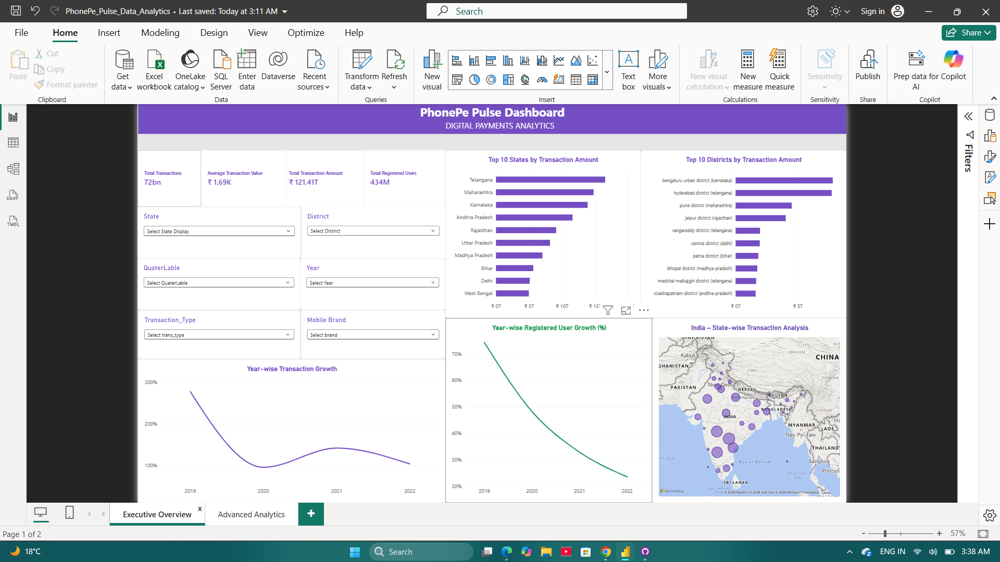

# PhonePe Pulse – Data Analytics Dashboard

An interactive Power BI project for analyzing digital payment transactions and registered user trends across India using the PhonePe Pulse dataset.

## Dashboard Preview

### Executive Overview


### Advanced Analytics


## Project Overview

This project analyzes PhonePe digital payment activity across Indian states and districts. It provides an interactive view of transaction performance, registered users, geographical distribution, rankings and year-over-year growth.

**Data period:** 2018–2022

## Dashboard Features

### Page 1 – Executive Overview
- Total Transactions
- Total Transaction Amount
- Average Transaction Value
- Total Registered Users
- Top 10 States by Transaction Amount
- Top 10 Districts by Transaction Amount
- India state-wise geographical visualization
- Transaction and registered user growth analysis
- Interactive filters for State, District, Quarter, Year, Transaction Type and Mobile Brand

### Page 2 – Advanced Analytics
- Dynamic Transaction Metric selector
- Dynamic User Metric selector
- Dynamic Growth Metric selector
- Dynamic Ranking Metric selector
- Year-wise transaction analysis
- Registered user trends
- Transaction and user YoY growth
- Top 10 state ranking based on selected metrics

## Tools and Technologies

- Microsoft Power BI Desktop
- Power Query
- DAX (Data Analysis Expressions)
- Data Modeling
- Dimension Tables and Relationships
- Interactive Field Parameters
- Geographical Data Visualization

## Data Modeling

The project uses cleaned transaction, user, map and top transaction/user datasets.

Dimension tables:
- DimState
- DimDistrict
- DimYear
- DimQuarter

## Key DAX Measures

- Total Transactions
- Total Transaction Amount
- Average Transaction Value
- Total Registered Users
- Transaction YoY Growth %
- User YoY Growth %
- District Transaction Amount
- Dynamic Ranking Value

## Repository Structure

```text
PhonePe-Pulse-PowerBI/
│
├── README.md
├── PhonePe_Pulse_Data_Analytics.pbix
├── Executive_Overview.png
└── Advanced Analytics.png
```

## How to Use

1. Download the Power BI `.pbix` file from this repository.
2. Open it using Power BI Desktop.
3. Explore both dashboard pages.
4. Use the available filters and metric selectors to analyze the data.

## Skills Demonstrated

- Data Cleaning and Transformation
- Data Modeling
- DAX Calculations
- KPI Development
- Interactive Dashboard Design
- Business Intelligence
- Data Visualization
- Analytical Reporting

## Disclaimer

This is an independent data analytics project based on PhonePe Pulse data. It is not affiliated with or endorsed by PhonePe.
